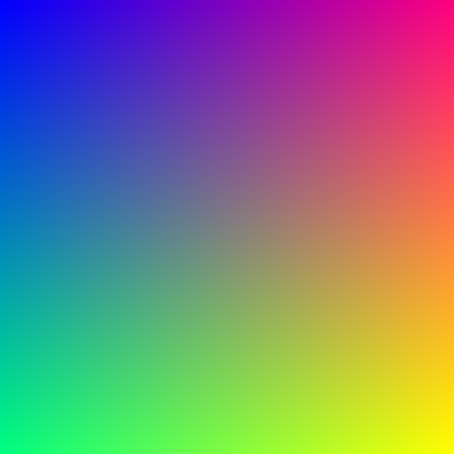
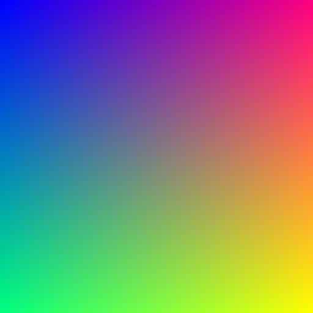
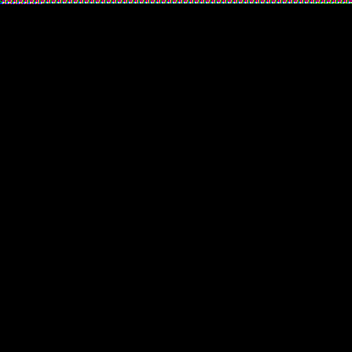
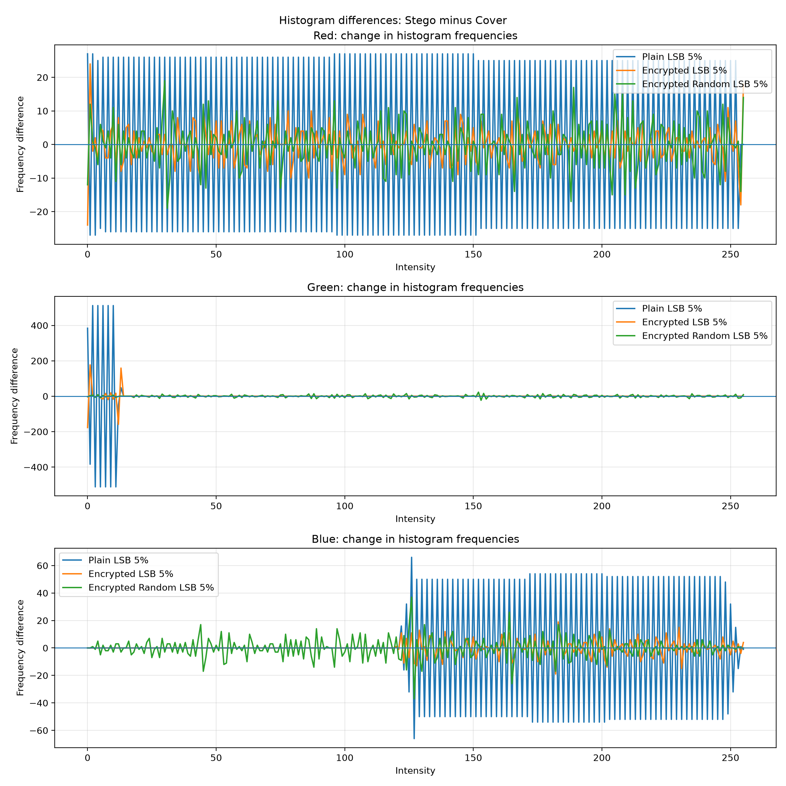

# Отчёт по лабораторной работе

## Исследование методов LSB-стеганографии с использованием AES-256-GCM

### 1. Цель работы

Цель работы — изучить метод сокрытия информации Least Significant Bit (LSB), реализовать его варианты с предварительным шифрованием и псевдослучайным выбором позиций встраивания, а также исследовать влияние объёма скрываемых данных на качество и статистические характеристики изображений.

### 2. Реализованные методы

В работе реализованы три метода стеганографии.

#### 2.1. Plain LSB

Исходное сообщение преобразуется в последовательность битов и последовательно записывается в младшие биты RGB-компонент пикселей изображения.

Перед сообщением записывается 4-байтовый заголовок, содержащий длину полезной нагрузки. Это позволяет определить размер сообщения при извлечении.

#### 2.2. Encrypted LSB

Перед встраиванием сообщение шифруется алгоритмом AES-256-GCM.

Для получения ключа из пароля используется PBKDF2-HMAC-SHA256.

Параметры шифрования:

| Параметр | Значение |
|---|---:|
| Алгоритм | AES-256-GCM |
| Длина ключа | 256 бит |
| Соль | 16 байт |
| Nonce | 12 байт |
| Тег аутентификации | 16 байт |
| Итерации PBKDF2 | 600 000 |
| Хеш-функция | SHA-256 |

Соль и nonce генерируются случайно. Они сохраняются вместе с шифротекстом, чтобы при извлечении можно было восстановить ключ и расшифровать сообщение.

Затем полученная полезная нагрузка встраивается в изображение последовательным способом.

#### 2.3. Encrypted Random LSB

В этом варианте сообщение также предварительно шифруется с помощью AES-256-GCM, однако позиции для встраивания выбираются псевдослучайно.

Для воспроизведения последовательности позиций используется генератор, инициализированный значением, полученным из SHA-256 от пароля.

При извлечении используется та же последовательность позиций.

### 3. Оценка качества изображений

Для сравнения исходных и модифицированных изображений использовались следующие показатели:

- MSE — среднеквадратичная ошибка;
- PSNR — пиковое отношение сигнала к шуму;
- SSIM — структурное сходство;
- Changed components — количество изменённых RGB-компонент;
- Changed ratio — доля изменённых компонент;
- распределение нулей и единиц в младших битах;
- критерий хи-квадрат для пар значений 2k и 2k+1.

MSE рассчитывается по формуле:

\[
MSE = \frac{1}{N}\sum_{i=1}^{N}(I_i-S_i)^2,
\]

где \(I_i\) — исходная компонента изображения, \(S_i\) — соответствующая компонента модифицированного изображения, а \(N\) — общее число компонент.

PSNR определяется как:

\[
PSNR = 10\log_{10}\left(\frac{255^2}{MSE}\right).
\]

Чем меньше MSE и чем больше PSNR и SSIM, тем ближе модифицированное изображение к исходному.

Для статистического анализа хи-квадрат сравниваются частоты значений в парах:

\[
(0,1), (2,3), \ldots, (254,255).
\]

Для каждой пары ожидаемая частота обоих значений принимается равной половине суммарной частоты пары.

### 4. Основной эксперимент

В основном эксперименте использовались два исходных изображения:

- `gradient.png`;
- `map.png`.

Для каждого изображения сравнивались Plain LSB, Encrypted LSB и Encrypted Random LSB.

Для обеспечения корректности сравнения размер полезной нагрузки выравнивался: открытое сообщение дополнялось до размера зашифрованной нагрузки.

#### 4.1. Исходные изображения

*Рисунок 1 — Исходное изображение gradient.png.*

*Рисунок 2 — Исходное изображение map.png.*

#### 4.2. Результаты для gradient.png

| Метод | MSE | PSNR | SSIM | Изменённые компоненты |
|---|---:|---:|---:|---:|
| Plain LSB | 0.000692 | 79.731 | 0.999998 | 544 |
| Encrypted LSB | 0.000832 | 78.932 | 0.999998 | 654 |
| Encrypted Random LSB | 0.000860 | 78.788 | 0.999986 | 676 |

Результаты показывают, что во всех трёх случаях визуальное сходство с исходным изображением остаётся очень высоким.

#### 4.3. Результаты для map.png

| Метод | MSE | PSNR | SSIM | Изменённые компоненты |
|---|---:|---:|---:|---:|
| Plain LSB | 0.000774 | 79.241 | 0.999999 | 609 |
| Encrypted LSB | 0.000829 | 78.945 | 0.999999 | 652 |
| Encrypted Random LSB | 0.000844 | 78.866 | 0.999991 | 664 |

Для изображения `map.png` также получены высокие значения SSIM и PSNR.

Следует учитывать, что исходные изображения имеют разные распределения цветовых значений, поэтому их статистические характеристики не обязаны совпадать.

#### 4.4. Модифицированные изображения

Результаты основного эксперимента представлены ниже.

**Gradient — Plain LSB**

**Gradient — Encrypted LSB**

**Gradient — Encrypted Random LSB**

*Рисунок 3 — Результаты трёх методов для gradient.png.*

**Map — Plain LSB**

**Map — Encrypted LSB**

**Map — Encrypted Random LSB**

*Рисунок 4 — Результаты трёх методов для map.png.*

### 5. Эксперимент с различным объёмом данных

Дополнительно был проведён эксперимент на изображении `gradient.png` размером 512 × 512 пикселей.

Изображение содержит:

\[
512 \cdot 512 \cdot 3 = 786432
\]

RGB-компоненты.

Были исследованы два уровня заполнения: приблизительно 1% и 5% доступных компонент.

#### 5.1. Результаты при заполнении 1%

| Метод | MSE | PSNR | SSIM | Changed ratio |
|---|---:|---:|---:|---:|
| Plain LSB | 0.004632 | 71.473 | 0.999958 | 0.004632 |
| Encrypted LSB | 0.005049 | 71.098 | 0.999960 | 0.005049 |
| Encrypted Random LSB | 0.004911 | 71.219 | 0.999919 | 0.004911 |

#### 5.2. Результаты при заполнении 5%

| Метод | MSE | PSNR | SSIM | Changed ratio |
|---|---:|---:|---:|---:|
| Plain LSB | 0.024464 | 64.246 | 0.999650 | 0.024464 |
| Encrypted LSB | 0.025230 | 64.112 | 0.999620 | 0.025230 |
| Encrypted Random LSB | 0.025056 | 64.142 | 0.999585 | 0.025056 |

#### 5.3. Анализ результатов

При увеличении объёма скрываемых данных с 1% до 5% показатели MSE возрастают, а PSNR уменьшается.

Это ожидаемо: чем больше компонент используется для встраивания, тем больше вероятность изменения исходного изображения.

При этом SSIM во всех рассмотренных случаях остаётся близким к единице. Следовательно, даже при заполнении 5% визуальная структура изображения сохраняется практически полностью.

В данной реализации каждая изменённая RGB-компонента отличается от исходной ровно на единицу. Поэтому квадрат разности для каждой изменённой компоненты равен единице, а для неизменённых — нулю. В результате MSE численно совпадает с долей изменённых компонент (Changed ratio).

#### 5.4. Изображения при заполнении 1%

**Plain LSB**

**Encrypted LSB**

**Encrypted Random LSB**

*Рисунок 5 — Результаты при заполнении 1%.*

#### 5.5. Изображения при заполнении 5%

**Plain LSB**

**Encrypted LSB**

**Encrypted Random LSB**

*Рисунок 6 — Результаты при заполнении 5%.*

### 6. Статистический анализ

Для изображения `gradient.png` были получены следующие значения статистики хи-квадрат:

| Заполнение | Метод | Chi-square | log10(p-value) |
|---|---|---:|---:|
| 1% | Plain LSB | 1046.86 | -95.39 |
| 1% | Encrypted LSB | 426.54 | -9.94 |
| 1% | Encrypted Random LSB | 575.19 | -25.86 |
| 5% | Plain LSB | 2624.08 | ниже численной точности |
| 5% | Encrypted LSB | 453.40 | -12.44 |
| 5% | Encrypted Random LSB | 541.90 | -21.90 |

Для открытого текста статистика хи-квадрат оказалась значительно выше. Это связано с тем, что последовательность битов обычного текста не является равномерно случайной.

Шифрование изменяет статистические свойства полезной нагрузки: биты шифротекста выглядят значительно более случайными. В результате статистика младших битов может отличаться от случая встраивания открытого текста.

Псевдослучайный выбор позиций дополнительно меняет характер распределения модификаций по изображению.

Следует учитывать, что критерий хи-квадрат не является универсальным средством обнаружения стеганографии. Его результаты зависят от исходного изображения, объёма данных и особенностей выбранного метода.

Значение `-inf` в таблице означает численную проблему при вычислении очень малого p-value, а не буквальное равенство вероятности нулю.

### 7. Визуальный анализ

#### 7.1. Карты различий

Карты различий позволяют увидеть компоненты изображения, изменённые в процессе встраивания.

**Plain LSB**

**Encrypted LSB**

**Encrypted Random LSB**

*Рисунок 7 — Карты различий при заполнении 5%.*

#### 7.2. Гистограммы

Гистограммы используются для сравнения распределения цветовых значений до и после модификации.

*Рисунок 8 — Сравнение гистограмм.*

Дополнительные графики распределения RGB-компонент:

*Рисунок 9 — RGB-гистограммы и различия между ними.*

### 8. Выводы

В ходе работы были реализованы три варианта LSB-стеганографии: встраивание открытого текста, встраивание зашифрованного текста и встраивание зашифрованных данных в псевдослучайные позиции.

Для защиты содержимого сообщения использовался AES-256-GCM с выводом ключа из пароля посредством PBKDF2-HMAC-SHA256.

Эксперименты показали, что при небольшом объёме скрываемых данных изменения изображения практически незаметны по метрикам MSE, PSNR и SSIM.

При увеличении объёма данных число изменённых компонент возрастает, а качество изображения постепенно снижается. Однако даже при заполнении 5% доступных компонент структурное сходство с исходным изображением остаётся очень высоким.

Статистический анализ показал различия между встраиванием открытого текста и зашифрованной полезной нагрузки. Вместе с тем результаты критерия хи-квадрат необходимо интерпретировать с учётом особенностей исходного изображения и ограничений самого теста.

Таким образом, работа продемонстрировала, что сочетание шифрования и LSB-стеганографии позволяет скрывать конфиденциальное содержимое сообщения внутри изображения, сохраняя при этом его высокое визуальное сходство с оригиналом.