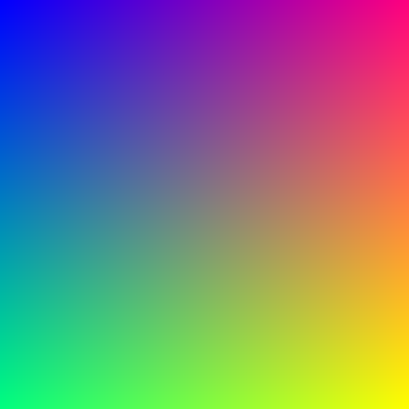
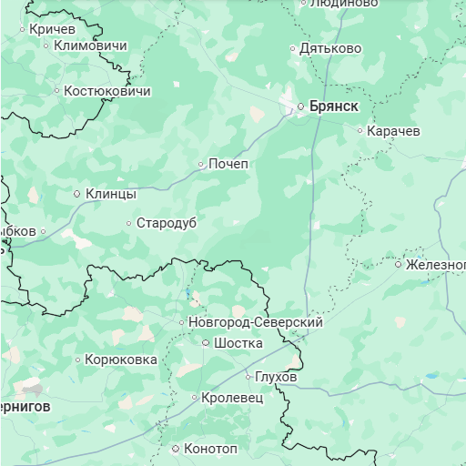
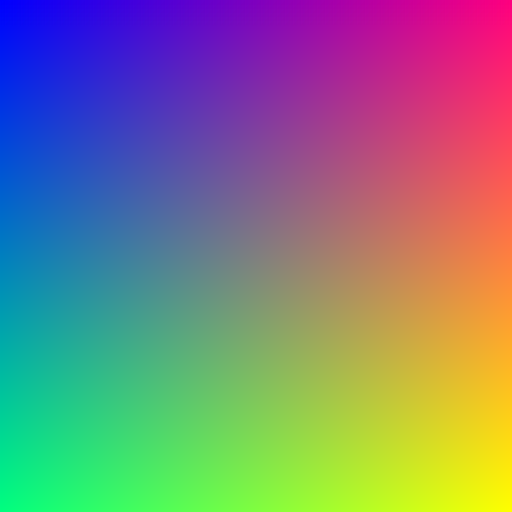
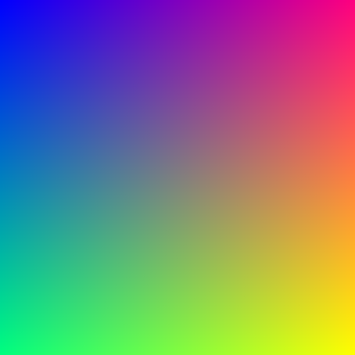
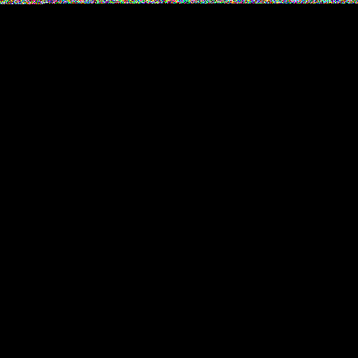
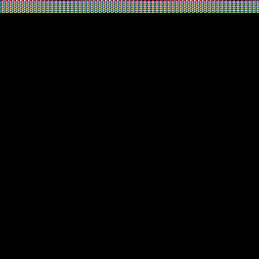
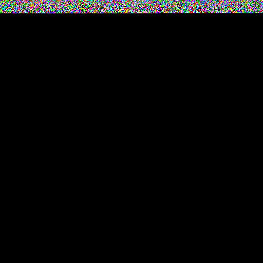
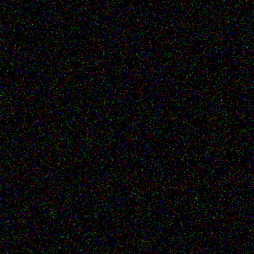
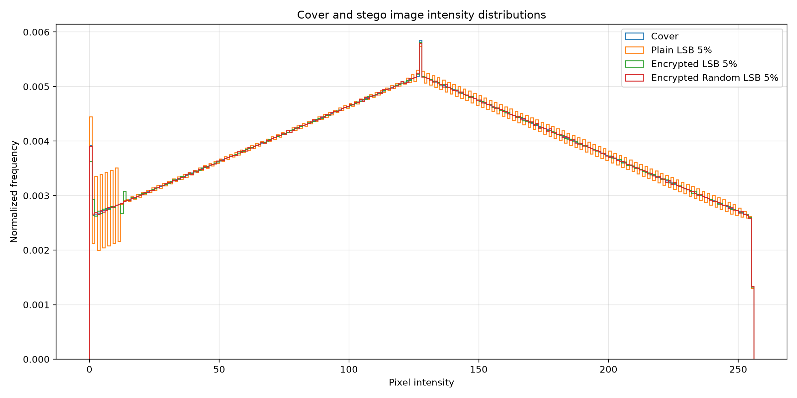
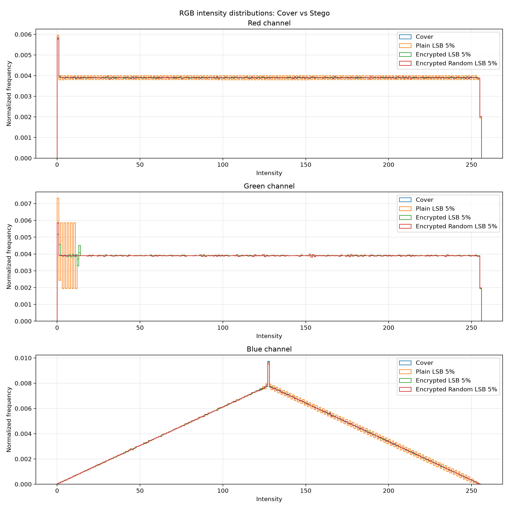

# Лабораторная работа: Стеганография методом LSB и шифрование данных

## 1. Цель работы

Цель лабораторной работы — изучить методы сокрытия информации в изображениях с использованием Least Significant Bit (LSB), реализовать встраивание открытых и зашифрованных данных, сравнить последовательное и псевдослучайное размещение информации, а также исследовать влияние объёма встраиваемых данных на качество изображения и его статистические характеристики.

В ходе работы реализованы три метода:

- **Plain LSB** — встраивание открытого сообщения;
- **Encrypted LSB** — встраивание зашифрованного сообщения с последовательным размещением;
- **Encrypted Random LSB** — встраивание зашифрованного сообщения с псевдослучайным размещением.

Для оценки результатов используются показатели MSE, PSNR и SSIM, количество изменённых компонент изображения, распределение младших битов и парный χ²-тест.

---

## 2. Теоретические сведения

### 2.1. Стеганография

Стеганография — это метод сокрытия информации внутри другого объекта таким образом, чтобы сам факт передачи скрытых данных был по возможности незаметен.

В данной работе в качестве носителя используются изображения. Встраивание осуществляется посредством изменения младших битов RGB-компонент пикселей. Поскольку изменение младшего бита влияет на значение компоненты максимум на единицу, визуальные изменения изображения обычно минимальны.

### 2.2. Метод Least Significant Bit (LSB)

В методе LSB информация записывается в младшие биты значений пикселей.

Для восьмибитной компоненты изображения изменение младшего бита позволяет изменить значение компоненты на единицу:

- если младший бит совпадает с встраиваемым битом, компонента не изменяется;
- если младший бит отличается, компонента увеличивается или уменьшается на единицу.

В реализации работы RGB-компоненты изображения рассматриваются как последовательный массив значений. Биты сообщения последовательно записываются в младшие биты выбранных компонент.

Перед полезной нагрузкой записывается четырёхбайтовый заголовок с длиной payload, необходимый для последующего извлечения сообщения.

### 2.3. Шифрование данных

Перед встраиванием сообщения в зашифрованных вариантах используется AES-256-GCM.

Для получения ключа применяется PBKDF2-HMAC-SHA256. В структуру зашифрованного payload входят соль, nonce и зашифрованные данные вместе с authentication tag.

Шифрование обеспечивает конфиденциальность содержимого сообщения даже в случае обнаружения стеганографического изображения.

### 2.4. Псевдослучайное размещение

В варианте Encrypted Random LSB позиции для встраивания выбираются псевдослучайным образом. Последовательность позиций воспроизводится с использованием пароля.

Это позволяет отказаться от последовательного размещения данных в начале массива компонент и распределить изменения по изображению.

---

## 3. Реализация

### 3.1. Plain LSB

В Plain LSB сообщение преобразуется в последовательность битов и записывается в младшие биты RGB-компонент изображения, начиная с начала массива.

Перед сообщением записывается заголовок длины payload, позволяющий определить размер данных при извлечении.

### 3.2. Encrypted LSB

В Encrypted LSB сообщение сначала шифруется AES-256-GCM, после чего полученный payload встраивается в изображение последовательным способом.

По сравнению с Plain LSB размер полезной нагрузки увеличивается за счёт криптографических данных: соли, nonce и authentication tag.

### 3.3. Encrypted Random LSB

В Encrypted Random LSB сообщение также шифруется AES-256-GCM, однако позиции встраивания выбираются псевдослучайно.

Для извлечения данных необходимо использовать тот же пароль, позволяющий воспроизвести последовательность позиций.

### 3.4. Использованные параметры

| Параметр | Значение |
|---|---|
| Алгоритм шифрования | AES-256-GCM |
| Размер ключа | 256 бит |
| Алгоритм получения ключа | PBKDF2-HMAC-SHA256 |
| Соль | 16 байт |
| Nonce | 12 байт |
| Authentication tag | 16 байт |
| Количество итераций PBKDF2 | 600000 |
| Формат выходных изображений | PNG |
| Цветовая модель | RGB |
| Методы встраивания | Plain LSB, Encrypted LSB, Encrypted Random LSB |

---

## 4. Методика экспериментов

Эксперименты проводились на двух исходных изображениях:

- `gradient.png`;
- `map.png`.

В первом эксперименте сравнивались три метода встраивания при использовании одного тестового сообщения.

Для обеспечения сопоставимости объёма встраиваемых данных Plain LSB использовал payload того же размера, что и зашифрованные варианты.

Во втором эксперименте исследовалось влияние объёма встраиваемых данных на качество изображения. Для изображения `gradient.png` использовались два уровня заполнения: 1% и 5% от доступных RGB-компонент.

Для каждого метода проверялись успешность встраивания и извлечения сообщения, а также рассчитывались показатели качества и статистические характеристики изображения.

---

## 5. Метрики оценки

### 5.1. Mean Squared Error (MSE)

Среднеквадратичная ошибка определяется как среднее квадратов разностей между соответствующими компонентами исходного и стеганографического изображений:

\[
MSE=\frac{1}{N}\sum_{i=1}^{N}(I_i-S_i)^2,
\]

где:

- \(I_i\) — компонента исходного изображения;
- \(S_i\) — компонента стеганографического изображения;
- \(N\) — общее количество компонент.

Чем меньше MSE, тем меньше изменения внесены в изображение.

### 5.2. Peak Signal-to-Noise Ratio (PSNR)

PSNR характеризует отношение максимального возможного значения сигнала к ошибке изменения изображения:

\[
PSNR=10\log_{10}\left(\frac{MAX^2}{MSE}\right).
\]

Для восьмибитных компонент RGB \(MAX=255\).

Чем выше PSNR, тем меньше различия между исходным и стеганографическим изображением. Для неизменённого изображения PSNR равен бесконечности.

### 5.3. Structural Similarity Index (SSIM)

SSIM оценивает структурное сходство изображений с учётом яркости, контраста и структуры.

Значения SSIM, близкие к единице, свидетельствуют о высокой визуальной схожести изображений.

### 5.4. Изменённые компоненты

Рассчитывается число компонент, отличающихся от исходного изображения, и доля изменённых компонент от общего количества:

\[
R=\frac{N_{\text{changed}}}{N_{\text{total}}}.
\]

### 5.5. Распределение LSB

Для изображения подсчитывается доля младших битов, равных нулю, и доля младших битов, равных единице.

Это позволяет исследовать изменение распределения младших битов в результате встраивания данных.

### 5.6. Парный χ²-тест

Для статистического анализа используется парный χ²-тест, сравнивающий частоты значений \(2k\) и \(2k+1\) для всех 128 пар восьмибитных значений.

Для каждой пары ожидаемые частоты определяются как:

\[
E_k=\frac{O_{2k}+O_{2k+1}}{2},
\]

где \(O_{2k}\) и \(O_{2k+1}\) — наблюдаемые частоты соответствующих значений.

Статистика теста:

\[
\chi^2=\sum_k
\left(
\frac{(O_{2k}-E_k)^2}{E_k}
+
\frac{(O_{2k+1}-E_k)^2}{E_k}
\right).
\]

В расчёте учитываются только непустые пары значений. Каждая такая пара даёт одну степень свободы, поскольку суммарная частота пары фиксирована, а проверяется соотношение между частотами двух значений.

Таким образом, число степеней свободы определяется количеством пар, для которых:

\[
O_{2k}+O_{2k+1}>0.
\]

По статистике χ² рассчитывается p-value. Для повышения численной точности используется библиотека `mpmath`, позволяющая вычислять регуляризованную верхнюю неполную гамма-функцию с повышенной точностью:

\[
p=Q\left(\frac{df}{2},\frac{\chi^2}{2}\right).
\]

Дополнительно вычисляется десятичный логарифм вероятности:

\[
\log_{10}(p).
\]

Использование логарифма позволяет сохранять информацию о чрезвычайно малых вероятностях, даже когда само значение p-value не представимо в стандартном формате чисел с плавающей точкой.

Данный тест является статистическим индикатором и сам по себе не представляет универсального способа обнаружения стеганографии.

---

## 6. Эксперимент 1. Сравнение методов встраивания

Для сравнения методов использовалось одно тестовое сообщение одинакового размера. В Plain LSB payload дополнялся до размера зашифрованного payload, чтобы обеспечить сопоставимый объём встраивания.

### 6.1. Результаты для gradient.png

| Метод | MSE | PSNR | SSIM | Изменённых компонент | Changed ratio | χ² | log₁₀(p) |
|---|---:|---:|---:|---:|---:|---:|---:|
| Cover | 0.000000 | ∞ | 1.000000 | 0 | 0.000000 | 582.492357 | −58.430113 |
| Plain LSB | 0.000692 | 79.731426 | 0.999998 | 544 | 0.000692 | 490.205920 | −43.086922 |
| Encrypted LSB | 0.000857 | 78.800816 | 0.999998 | 674 | 0.000857 | 446.658715 | −36.161470 |
| Encrypted Random LSB | 0.000829 | 78.944939 | 0.999986 | 652 | 0.000829 | 582.777616 | −58.478718 |

### 6.2. Результаты для map.png

| Метод | MSE | PSNR | SSIM | Изменённых компонент | Changed ratio | χ² | log₁₀(p) |
|---|---:|---:|---:|---:|---:|---:|---:|
| Cover | 0.000000 | ∞ | 1.000000 | 0 | 0.000000 | 662596.884335 | −143656.249605 |
| Plain LSB | 0.000774 | 79.241242 | 0.999999 | 609 | 0.000774 | 662910.038209 | −143724.239126 |
| Encrypted LSB | 0.000846 | 78.859199 | 0.999999 | 665 | 0.000846 | 662956.436264 | −143734.312709 |
| Encrypted Random LSB | 0.000835 | 78.911762 | 0.999992 | 657 | 0.000835 | 660367.611983 | −143172.247568 |

### 6.3. Анализ результатов

В обоих изображениях визуальные изменения остаются очень небольшими. Значения PSNR превышают 78 дБ, а SSIM практически равен единице. Это подтверждает, что внедрение данных методом LSB почти не влияет на визуальное восприятие изображения.

Plain LSB имеет несколько меньшие значения MSE и количество изменённых компонент по сравнению с зашифрованными методами. Это связано с различиями между встраиваемыми последовательностями битов. При изменении младшего бита компонента её значение изменяется на единицу, поэтому количество изменённых компонент непосредственно влияет на MSE.

Encrypted LSB и Encrypted Random LSB демонстрируют близкие показатели визуального качества. Псевдослучайное размещение не приводит к заметному улучшению MSE или PSNR в данном эксперименте, однако изменяет характер распределения модификаций по изображению.

Особенно заметно различие статистических характеристик исходных изображений. Для `gradient.png` значения log₁₀(p) имеют порядок десятков, тогда как для `map.png` они достигают порядка сотен тысяч.

Это объясняется тем, что χ²-тест чувствителен к исходному распределению интенсивностей изображения. У `map.png` распределение значений RGB-компонент сильно отличается от равномерного распределения частот внутри пар соседних значений. Поэтому очень малые p-value наблюдаются уже для исходного изображения Cover.

Следовательно, абсолютные значения p-value нельзя интерпретировать как универсальную оценку наличия или отсутствия скрытых данных. Для корректного анализа необходимо учитывать статистические свойства исходного изображения.

---

## 7. Эксперимент 2. Влияние объёма встраиваемых данных

В данном эксперименте использовалось изображение `gradient.png`. Сравнивались три метода встраивания при заполнении 1% и 5% от доступных RGB-компонент.

Размеры полезной нагрузки составляли:

- 1% — 979 байт;
- 5% — 4911 байт.

### 7.1. Результаты при заполнении 1%

| Метод | Payload, байт | MSE | PSNR | SSIM | Changed ratio | χ² | log₁₀(p) |
|---|---:|---:|---:|---:|---:|---:|---:|
| Plain LSB | 979 | 0.004632 | 71.472824 | 0.999958 | 0.004632 | 1046.856876 | −143.275742 |
| Encrypted LSB | 979 | 0.004939 | 71.194623 | 0.999962 | 0.004939 | 421.955136 | −32.343929 |
| Encrypted Random LSB | 979 | 0.004945 | 71.189036 | 0.999918 | 0.004945 | 572.295746 | −56.697022 |

### 7.2. Результаты при заполнении 5%

| Метод | Payload, байт | MSE | PSNR | SSIM | Changed ratio | χ² | log₁₀(p) |
|---|---:|---:|---:|---:|---:|---:|---:|
| Plain LSB | 4911 | 0.024464 | 64.245590 | 0.999650 | 0.024464 | 2624.080168 | −460.656985 |
| Encrypted LSB | 4911 | 0.024885 | 64.171507 | 0.999626 | 0.024885 | 438.580752 | −34.903616 |
| Encrypted Random LSB | 4911 | 0.025005 | 64.150476 | 0.999586 | 0.025005 | 529.724355 | −49.557860 |

### 7.3. Анализ результатов

При увеличении объёма встраиваемых данных с 1% до 5% наблюдается увеличение MSE и снижение PSNR. Это ожидаемый результат, поскольку с ростом payload требуется изменять больше младших битов исходного изображения.

SSIM при заполнении 1% остаётся близким к единице. При 5% он несколько снижается, однако по-прежнему демонстрирует высокое структурное сходство между исходным изображением и результатами встраивания.

Plain LSB обеспечивает несколько меньшие изменения исходного изображения. Зашифрованные варианты требуют встраивания другой битовой последовательности, что приводит к небольшому увеличению числа изменённых компонент.

Encrypted LSB и Encrypted Random LSB имеют близкие значения MSE, PSNR и SSIM. Следовательно, в рамках данного эксперимента псевдослучайное размещение не оказывает существенного влияния на визуальное качество по сравнению с последовательным размещением.

При этом статистические характеристики младших битов изменяются с увеличением объёма внедряемых данных. Для Plain LSB при заполнении 5% наблюдается особенно большое значение χ² и log₁₀(p) около −460.66. Это указывает на выраженное различие между наблюдаемыми и ожидаемыми частотами пар значений.

Однако данный результат нельзя рассматривать отдельно от исходного распределения изображения и особенностей самого теста. χ²-тест проверяет конкретное статистическое свойство, а не обнаруживает стеганографию вообще.

---

## 8. Визуальное сравнение изображений

### 8.1. Основной эксперимент

Визуально стеганографические изображения практически не отличаются от исходных изображений.

#### Gradient

#### Map

### 8.2. Эксперимент с заполнением 1% и 5%

При увеличении объёма внедряемых данных визуальные изменения становятся более выраженными на картах различий, однако в исходных изображениях они остаются малозаметными.

#### Заполнение 1%

#### Заполнение 5%

### 8.3. Карты различий

Карты различий позволяют визуально увидеть изменения компонент, которые практически незаметны на исходных изображениях.

---

## 9. Гистограммы

Для дополнительного анализа были построены гистограммы распределения RGB-компонент и их различий.

Гистограммы позволяют оценить изменение распределения интенсивностей компонент изображения после встраивания данных. Изменение младших битов может влиять на частоты соседних значений интенсивностей, что важно для статистического анализа стеганографических изображений.

---

## 10. Выводы

В ходе лабораторной работы были реализованы три метода стеганографического встраивания данных в изображения: Plain LSB, Encrypted LSB и Encrypted Random LSB.

В Plain LSB информация встраивается непосредственно, без предварительного шифрования. В двух других методах используется AES-256-GCM, причём Encrypted LSB выполняет последовательное встраивание, а Encrypted Random LSB использует псевдослучайные позиции.

Результаты экспериментов показали, что все три метода обеспечивают успешное встраивание и извлечение данных. Визуальное качество изображений остаётся высоким: значения SSIM близки к единице, а PSNR сохраняет высокие значения даже при заполнении 5%.

При увеличении объёма payload с 1% до 5% увеличиваются MSE и количество изменённых компонент, а PSNR снижается. Это соответствует ожидаемому поведению метода LSB.

Plain LSB в проведённых экспериментах показал несколько меньшие изменения исходных изображений. Encrypted LSB и Encrypted Random LSB продемонстрировали близкие показатели визуального качества, поэтому псевдослучайное размещение не обеспечило существенного улучшения визуальных метрик в рамках проведённых тестов.

Статистический анализ с помощью парного χ²-теста позволил оценить изменения распределения частот пар соседних значений интенсивностей. В ходе исправления реализации количество степеней свободы было приведено в соответствие с числом непустых пар. Дополнительно вычисление p-value было переведено на повышенную точность с использованием `mpmath`, что позволило получать конечные значения log₁₀(p) даже для чрезвычайно малых вероятностей.

При интерпретации статистических результатов необходимо учитывать исходное распределение интенсивностей изображения. В частности, для `map.png` очень малые p-value наблюдаются и без встраивания данных. Поэтому χ²-тест не следует рассматривать как универсальный способ обнаружения стеганографии.

Таким образом, метод LSB позволяет встраивать данные с небольшими визуальными изменениями изображения. Предварительное шифрование повышает конфиденциальность содержимого скрытого сообщения, а псевдослучайное размещение изменяет схему встраивания, но в проведённых экспериментах не обеспечило существенного улучшения визуальных метрик.
